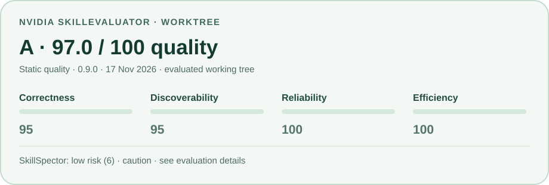

<p align="center"></p>

# worktree

[MIT](LICENSE)

Manage an isolated Git worktree through creation, setup, saving, applying and deletion.

## How it works

| Step | What happens |
| --- | --- |
| Create | Make a worktree from the current branch and set up dependencies |
| Save | Commit task work; push only when requested |
| Apply | Merge into its recorded parent and run checks |
| Delete | Remove the worktree after approval |

## Quick start

```bash
npx skills add illescasDaniel/worktree-skill
```

For manual installation, details and limitations, see the [guide](docs/guide.md).

## Requirements and limits

Git 2.22 or newer; environment setup depends on your project. Agent instructions are conventions, not sandbox boundaries.

## Evaluation

[](docs/evaluation.md)

SkillEvaluator 0.9.0 gave **A, 97.0/100** on the evaluated working tree. Tier 1 passed. The security scanner reported low risk, with a caution recommendation. Static heuristics do not measure agent performance. [Evaluation details](docs/evaluation.md).

## Tests

The skill contains instructions rather than scripts. Its Git commands were exercised in a temporary repository; live agent behavior was not evaluated.

## License

[MIT](LICENSE).
